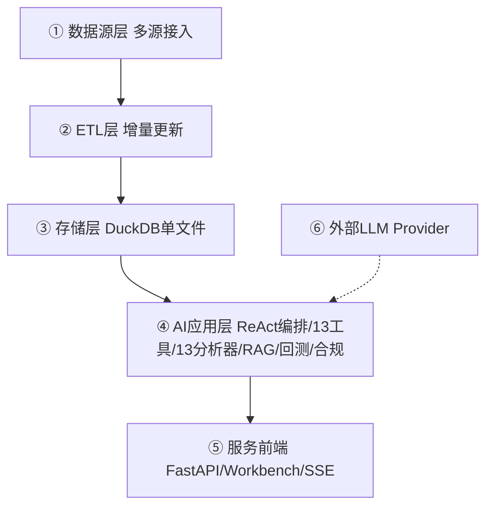

# QuantPilot · 智研量化工作台

> 本地化 AI 量化投研工作台：DuckDB 多源数据底座 + ReAct 智能体 + RAG 知识库 + 自然语言回测，纯本地、零服务端部署、数据不出本机。

QuantPilot 把「数据 → 因子 → AI 投研 → 回测」整合成一个**在本机跑、不依赖云端数据库**的研究环境。它以 DuckDB 单文件数据库为底座，汇聚行情 / 财务 / 因子 / 产业链等多源数据，并通过 ReAct 智能体把大模型编排成可白名单调用的工具，支持 RAG 检索问答、自然语言转代码回测、合规护栏与综合分析报告。

---

## ✨ 核心特性

- 🗄️ **单文件数据底座**：DuckDB 一个 `.duckdb` 文件搞定行情 / 财务 / 因子 / 向量，零运维、可随仓库移动。
- 🔌 **多源增量接入**：新浪行情、AkShare（东财 / 研报 / 公告）、adata 基础信息、新浪财务摘要，每日定时增量更新。
- 🤖 **ReAct 投研智能体**：`react.py` 编排，13 个白名单数据 / 分析工具 + 13 个分析器（估值 / 风险 / 行业 / 宏观 / 情绪等），最多 6 步推理循环。
- 📚 **本地 RAG 知识库**：PDF / 研报 / 公告 切片 → 本地向量嵌入 → 相似检索 → 重排过滤 → 带引用溯源的回答。
- 🧪 **自然语言回测沙箱**：把投研问题转成回测代码，在受控沙箱中执行，结果回流到对话。
- 🛡️ **合规护栏**：所有对外结论经合规改写 + 免责声明 + 置信度评估，并生成追问建议。
- 🧩 **可插拔存储层**：`get_db()` 工厂抽象，DuckDB 为默认实现，预留 Postgres / Chroma / Qdrant 后端演进空间。
- 🌐 **Web 工作台**：FastAPI + Workbench 前端，SSE 流式进度，SQL 端点强制只读。

---

## 🏗️ 系统架构

```
① 数据源层        ② ETL 层              ③ 存储层(DuckDB)      ④ AI 应用层              ⑤ 服务/前端层      ⑥ 外部 LLM
新浪/AkShare/adata  update_kline_fast     行情/财务/因子/市值     ReAct 编排(react)        FastAPI(ai_routes)  MiniMax / Qwen
外部PDF/研报/公告   daily_update 调度     向量知识库/会话记录     13工具+13分析器+RAG        Workbench + SSE     DeepSeek / Mock
                     data_ingest/*          → 统一 Database 抽象    回测沙箱 / 合规护栏
                     analysis/factors 重算
```



**一次问答的链路**：用户提问 → 意图识别（闲聊 / 投研）→ 预取真实行情快照防幻觉 → ReAct 推理循环（调白名单工具、回填观测）→ 结构化结果转自然语言 → 合规改写 + 免责声明 → 置信度 + 追问建议。

---

## 📁 目录结构

```
quant_db/
├── data/quant.duckdb          # 主数据库（单文件，已被 .gitignore 忽略）
├── etl/                       # 数据接入与更新
│   ├── db.py                  # DuckDB 连接（get_conn）
│   ├── schema.sql             # 表结构 DDL（幂等）
│   ├── backfill.py            # 首次全量回填
│   └── daily_update.py        # 每日增量更新（job_runner 调度）
├── data_ingest/               # 各业务域采集（财务 / 公告 / 新闻）
├── analysis/                  # 因子重算(factors.py) / SQL 查询
├── ai/                        # 大模型应用核心
│   ├── client.py              # 统一 LLM 客户端（MiniMax/Qwen/DeepSeek/Mock）
│   ├── react.py               # ReAct 智能体编排
│   ├── tools/                 # 13 个白名单工具
│   └── analyzers/             # 13 个分析器
├── knowledge/                 # RAG 知识库
│   ├── loader.py chunker.py embedder.py
│   ├── vector_store.py        # 向量存储（DuckDB / 可切 Chroma）
│   └── rag_chain.py           # 检索→重排→生成 链路
├── backtest/                  # 自然语言转代码回测沙箱
├── compliance/                # 金融合规护栏
├── web/                       # FastAPI + Workbench 前端
│   ├── app.py server.py       # 服务入口（localhost:8765）
│   └── routes/ai_routes.py    # AI 接口
├── scripts/                   # 启动 / 定时任务脚本
├── launchd/                   # macOS 定时任务 plist
├── requirements.txt
└── .env.example               # 密钥模板（无真实值）
```

---

## 🚀 快速开始

### 1. 环境准备
```bash
cd /Users/quanlin/Desktop/项目/AI量化/quant_db   # 或你的项目路径
python3 -m venv .venv && source .venv/bin/activate
pip install -r requirements.txt
```

### 2. 配置 LLM 密钥（可选，不配则用 Mock 模板模式）
```bash
cp .env.example .env
# 编辑 .env，填入你的 API Key（.env 已被 .gitignore 忽略，不会入库）
```
可用 `LLM_PROVIDER` 切换 `minimax` / `qwen` / `deepseek` / `mock`。

### 3. 初始化数据库
```bash
python3 -c "from etl.db import init_schema; init_schema()"
```

### 4. 首次全量回填（可先用 --limit 小数据验证）
```bash
python3 -m etl.backfill --limit 5     # 5 只票试跑
python3 -m etl.backfill               # 全市场（约 30+ 分钟）
```

### 5. 启动 Web 工作台
```bash
bash scripts/run_web.sh
# 浏览器打开 http://localhost:8765
```
启动后状态条显示 🟡 MOCK（无 key）或 🟢 LIVE（已配真实 LLM）。

---

## 🔄 数据更新

```bash
# 每日增量（最近 30 天）
python3 -m etl.daily_update

# 只更新 K 线最近 5 天
python3 -m etl.daily_update --only kline --datalen 5

# macOS 定时任务（每日 17:00）
bash scripts/install_launchd.sh install     # 安装
bash scripts/install_launchd.sh run-now     # 立即跑一次
bash scripts/install_launchd.sh uninstall   # 卸载
```

---

## 🤖 AI 投研能力

| 能力 | 说明 |
|---|---|
| **ReAct 智能体** | `react.py` 主循环，意图识别 → 预取真实行情防幻觉 → 最多 6 步「思考-调工具-观测」循环 → 收口合成。 |
| **13 个白名单工具** | 实时行情、财务 / 摘要、个股对比、知识库检索、回测执行、投资建议、联网 / 研报 / 宏观 / 行业搜索等。 |
| **13 个分析器** | 财务 / 估值 / 风险、DCF / 盈利 / 对比、行业 / 宏观 / 情绪、综合分析报告。 |
| **RAG 知识库** | 文档解析 → 段落切片 → 本地嵌入 → 向量检索 → 基于 `stock_code` / `section` 元数据的重排与过滤 → 带引用回答。 |
| **回测沙箱** | 自然语言 → 回测代码 → 受控沙箱执行 → 结果回流对话。 |
| **合规护栏** | 对外结论强制合规改写 + 免责声明 + 置信度评分 + 追问建议。 |
| **综合分析报告** | 六章结构、引用完整性校验、缺引用时确定性重建来源清单。 |

---

## 🔑 配置真实 LLM

| Provider | 环境变量 | 模型 |
|---|---|---|
| **MiniMax**（默认）| `LLM_PROVIDER=minimax` + `MINIMAX_API_KEY` | MiniMax-M3 / M2.7 / M3.1-Flash-Preview |
| Qwen | `LLM_PROVIDER=qwen` + `QWEN_API_KEY` | qwen-plus / qwen-long |
| DeepSeek | `LLM_PROVIDER=deepseek` + `DEEPSEEK_API_KEY` | deepseek-chat |
| Mock | `LLM_PROVIDER=mock` | 无 key，模板化回答 |

在 `.env` 中设置后重启服务即可；也可直接 `export` 环境变量。

---

## 🌐 Web UI 与 API

**访问**：`http://localhost:8765`

**数据类端点**：
| 端点 | 说明 |
|---|---|
| `GET /api/health` | 健康检查 |
| `GET /api/stats` | 各表行数 |
| `GET /api/snapshot` | 最新一日全市场列表 |
| `GET /api/stock/{code}` | 个股信息 + 最新价 |
| `GET /api/stock/{code}/daily` | 日 K |
| `GET /api/stock/{code}/factors` | Alpha 因子 |
| `POST /api/sql` `{"sql": "..."}` | 仅允许 SELECT/WITH/EXPLAIN 的只读查询 |

**AI 类端点**（`/api/v1/*`）：
- `POST /ai/analyze`、`GET /ai/history`、`GET /ai/result/{id}`
- `POST /rag/upload`、`GET /rag/docs`、`POST /rag/query`
- `GET/POST /watchlist/groups`、`GET/POST /notes`
- `GET/POST /portfolio/positions`、`POST /portfolio/review`
- `GET/POST /memory`、`POST /ingest/news`

> **安全**：所有 DuckDB 连接为 `read_only=True`，SQL 端点会拒绝所有 DDL / DML 关键字，物理上无法破坏数据库。

---

## 🧱 技术栈

`Python` · `DuckDB` · `FastAPI` · `uvicorn` · `OpenAI SDK` · `Chroma`(向量) · `PyMuPDF` · `python-docx` · `RapidOCR` · `adata` / `AkShare` · `React`(前端) · `SSE`

---

## 🔒 安全与隐私

- **密钥不入库**：所有 API Key 通过环境变量 / `.env` 读取，源码无硬编码；`.env` 已加入 `.gitignore`。
- **数据库只读暴露**：Web SQL 端点强制只读，无法改写数据文件。
- **数据不出本机**：默认全部在本地运行，不调用任何第三方数据上报。
- 若后续接入 Postgres / Chroma / Qdrant，可通过 `get_db()` 工厂与 `vector_store` 后端切换，密钥管理策略不变。

---

## 🗺️ 路线规划

- [ ] 多 Agent 协作工作流（数据检索 + 风险审查 + 观点汇总）
- [ ] 存储层双后端：本地 DuckDB + 可选 Postgres / 专用向量库（Chroma / Qdrant）
- [ ] 研报 OCR 全量接入（扫描件 PDF）
- [ ] 估值模型 v2（DCF + 敏感性分析）
- [ ] 移动端 PWA

---

## ⚠️ 免责声明

本项目为**个人量化研究与学习工具**，**不构成任何投资建议**。所有 AI 生成内容均含免责声明，请独立判断、自负盈亏。作者不对使用本项目产生的任何投资决策或损失负责。本项目**未接入任何实盘交易接口**，仅用于离线研究与回测。
